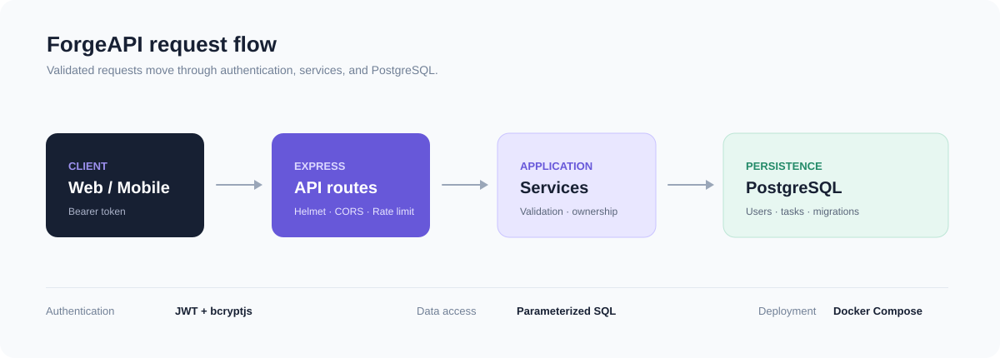

# ForgeAPI

ForgeAPI is a PostgreSQL-backed task management API built with Express and Node.js. It uses JWT authentication, Zod validation, parameterized SQL, and ownership checks in every task query.



## Setup

Prerequisites: Node.js 22+, npm, and PostgreSQL 14+ (or Docker).

```bash
cp .env.example .env
npm install
npm run migrate
npm run dev
```

With Docker: `cp .env.example .env && docker compose up --build`.

The API listens on `http://localhost:4000`. `GET /api/v1/health` is public.

## Architecture

```text
src/config       environment validation
src/controllers  HTTP handlers
src/db           PostgreSQL pool and migrations runner
src/middleware   authentication and error handling
src/routes       API route definitions
src/services     database-backed business logic
src/validators   Zod request schemas
migrations       SQL up/down migrations
tests             Node test runner and Supertest checks
```

Controllers stay thin; services own SQL and all user-supplied values are passed as parameters. Task queries include `user_id`, so users cannot read or change another user's tasks.

## Endpoints

Register: `POST /api/v1/auth/register` with `{ "email": "jordan@example.com", "password": "correct-horse-battery" }`.

Login: `POST /api/v1/auth/login` with the same body. The response contains a JWT. Send it as `Authorization: Bearer <token>` for:

- `GET /api/v1/auth/me`
- `POST /api/v1/tasks` with `{ "title": "Ship release", "priority": "high" }`
- `GET /api/v1/tasks?search=ship&status=todo&priority=high&sort=updated_at&order=desc&page=1&limit=20`
- `GET /api/v1/tasks/:id`
- `PATCH /api/v1/tasks/:id`
- `DELETE /api/v1/tasks/:id`

List responses include `data` and `pagination` with `page`, `limit`, `total`, and `pages`. Invalid input returns `400`; missing or invalid tokens return `401`; missing owned resources return `404`.

## Migrations and checks

```bash
npm run migrate
npm run migrate:down
npm test
npm run lint
```

Tests do not connect to a developer database: they cover public routes and validation boundaries. Database integration tests require a separate test database and are not claimed here.

## Deployment notes

Run Node behind a trusted reverse proxy or managed platform that terminates TLS. Set `NODE_ENV=production`, configure `CORS_ORIGIN` to the real frontend origin, use a strong secret from the deployment secret manager, and set `trust proxy` to match the actual proxy topology. Local development intentionally uses HTTP; TLS certificate verification is never disabled.

Known limitations: there is no refresh-token or email-verification flow, and the API currently has no task assignment or audit log model.
